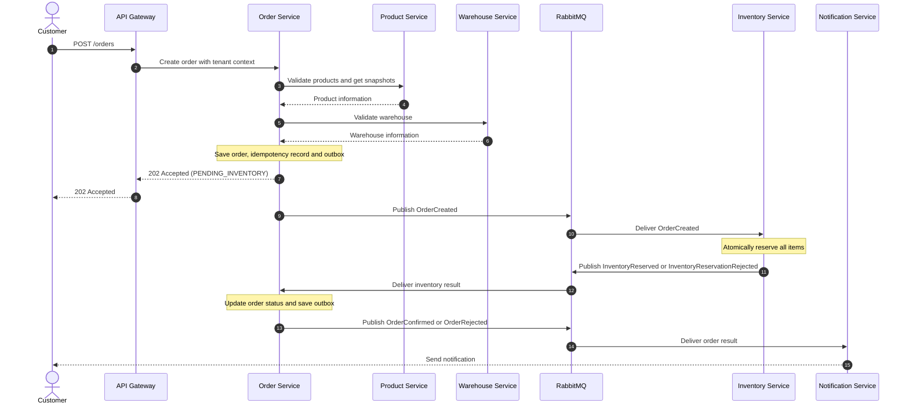

# Order and Inventory Workflow

## 1. Purpose

This document describes how StockFlow processes a customer order and reserves inventory across the Order Service and Inventory Service.

The workflow uses asynchronous communication through RabbitMQ and follows the Saga choreography pattern.

The primary objective is to ensure that an order is confirmed only after inventory has been successfully reserved.

## 2. Scope

This workflow covers:

- Order creation.
- Product and warehouse validation.
- Inventory reservation.
- Order confirmation or rejection.
- Order cancellation and inventory release.
- Reliable event publishing and consumption.
- Duplicate message handling and failure recovery.

Payment processing is outside the scope of the MVP.

## 3. Actors and Services

| Actor / Service | Responsibility |
|---|---|
| Customer / API Client | Submits an order request |
| API Gateway | Authenticates requests and forwards trusted tenant context |
| Order Service | Creates orders and manages order lifecycle |
| Product Service | Validates products and provides product information |
| Warehouse Service | Validates warehouse information |
| RabbitMQ | Transports asynchronous events |
| Inventory Service | Validates stock and manages reservations |
| Notification Service | Sends order-related notifications |

Each business service owns its database. No service directly accesses another service's database.

## 4. Preconditions

Before an order is created:

1. The customer must be authenticated.
2. The request must belong to a valid tenant.
3. The tenant must have permission to create orders.
4. The requested products must exist and be active.
5. The selected warehouse must belong to the tenant and be active.
6. The order must contain at least one item.
7. Every item must have a valid quantity greater than zero.

The Order Service validates product and warehouse information through their respective service APIs before accepting the order.

## 5. Main Success Workflow

### Step 1: Customer submits an order

The customer sends:

`POST /orders`

The request contains:

- Warehouse ID.
- Sales channel.
- Product IDs.
- Quantities.
- Idempotency key in the request header.

The API Gateway authenticates the request and provides trusted tenant and user context to the Order Service.

### Step 2: Order Service validates the request

The Order Service:

1. Validates the request structure.
2. Checks the idempotency key and request hash.
3. Validates the requested products through Product Service.
4. Retrieves product information and price snapshots.
5. Validates the warehouse through Warehouse Service.
6. Verifies that the warehouse belongs to the same tenant.

If validation fails, the request is rejected and no order is created.

### Step 3: Order Service creates a pending order

The Order Service starts a local database transaction.

Within the same transaction, it:

1. Creates the order.
2. Creates its order items with product, SKU, and price snapshots.
3. Sets the order status to `PENDING_INVENTORY`.
4. Saves the idempotency record.
5. Creates an `OrderCreated` event in its outbox table.

The transaction commits.

The API returns:

`HTTP 202 Accepted`

The response indicates that the order has been accepted for processing. It does **not** mean that inventory has been reserved or that the order is confirmed.

### Step 4: Order Service publishes the event

The Order Service's outbox publisher:

1. Reads unpublished outbox records.
2. Publishes `OrderCreated` to RabbitMQ.
3. Waits for publisher confirmation.
4. Marks the outbox record as published after successful confirmation.

If RabbitMQ is unavailable, the event remains in the outbox and can be retried.

### Step 5: Inventory Service processes the event

The Inventory Service consumes `OrderCreated`.

It:

1. Checks whether the event has already been processed.
2. Validates the tenant, warehouse, and product references.
3. Checks available stock for every order item.
4. Attempts to reserve all requested quantities.

The reservation must be atomic:

- If every item has sufficient stock, reserve all items.
- If any item has insufficient stock, reserve none.

The Inventory Service uses a local database transaction and appropriate database concurrency controls to prevent overselling.

### Step 6: Inventory Service publishes the result

If reservation succeeds, the Inventory Service:

1. Saves the reservation.
2. Saves reservation items.
3. Records inventory movements.
4. Records the processed event.
5. Adds `InventoryReserved` to its outbox.

If reservation fails because of insufficient stock, it:

1. Makes no partial reservation.
2. Records the processed event.
3. Adds `InventoryReservationRejected` to its outbox.

The transaction commits before the result event is published.

### Step 7: Order Service processes the result

The Order Service consumes the inventory result event.

For `InventoryReserved`:

1. Checks whether the event has already been processed.
2. Verifies the order is still awaiting inventory.
3. Updates the order status to `CONFIRMED`.
4. Records the status history.
5. Adds an `OrderConfirmed` event to its outbox.

For `InventoryReservationRejected`:

1. Checks whether the event has already been processed.
2. Verifies the order is still awaiting inventory.
3. Updates the order status to `REJECTED`.
4. Records the rejection reason and status history.
5. Adds an `OrderRejected` event to its outbox.

Each operation is performed in a local Order Service database transaction.

### Step 8: Notification Service sends a notification

The Notification Service consumes `OrderConfirmed` or `OrderRejected`.

It sends an appropriate notification to the customer.

Notification failures must not roll back or block order and inventory processing.

## 6. Order Cancellation Workflow

When a customer cancels an already confirmed order:

1. Order Service verifies that cancellation is allowed.
2. Order status changes from `CONFIRMED` to `CANCELLATION_PENDING`.
3. Order Service saves `OrderCancellationRequested` in its outbox.
4. The event is published to RabbitMQ.
5. Inventory Service consumes the event and releases the reservation.
6. Inventory Service records the release and adds `InventoryReleased` to its outbox.
7. Order Service consumes `InventoryReleased`.
8. Order status changes from `CANCELLATION_PENDING` to `CANCELLED`.

The order must not be marked `CANCELLED` until inventory release has been successfully confirmed.

If inventory release fails, the order remains `CANCELLATION_PENDING` until retry or reconciliation resolves the issue.

## 7. Order State Transitions

| Current Status | Event / Action | Next Status |
|---|---|---|
| — | Order created | `PENDING_INVENTORY` |
| `PENDING_INVENTORY` | Inventory reserved | `CONFIRMED` |
| `PENDING_INVENTORY` | Inventory reservation rejected | `REJECTED` |
| `CONFIRMED` | Cancellation requested | `CANCELLATION_PENDING` |
| `CANCELLATION_PENDING` | Inventory released | `CANCELLED` |

Invalid or unexpected transitions must be rejected.

For example, an order that is already `REJECTED` must not become `CONFIRMED` because of a duplicate or late event.

## 8. Event Envelope

All integration events should follow a common envelope structure.

```json
{
  "eventId": "unique-event-id",
  "eventType": "OrderCreated",
  "eventVersion": 1,
  "occurredAt": "2026-11-04T10:00:00.000Z",
  "producer": "order-service",
  "tenantId": "tenant-id",
  "correlationId": "workflow-id",
  "causationId": "causing-event-id",
  "payload": {
    "orderId": "order-id",
    "warehouseId": "warehouse-id",
    "items": [
      {
        "productId": "product-id",
        "quantity": 2
      }
    ]
  }
}
```

The envelope provides:

- `eventId`: Unique event identifier.
- `eventType`: Event name.
- `eventVersion`: Contract version.
- `occurredAt`: Event creation time.
- `producer`: Publishing service.
- `tenantId`: Tenant context.
- `correlationId`: Identifier connecting events in the same workflow.
- `causationId`: Identifier of the event that caused this event.
- `payload`: Event-specific information.

Events must never contain passwords, access tokens, refresh tokens, or other secrets.

## 9. Transaction Boundaries

There is no distributed database transaction across services.

Each service commits only its own database transaction.

| Operation | Database Owner | Transaction Contents |
|---|---|---|
| Order creation | Order Service | Order, items, idempotency record, outbox event |
| Inventory reservation | Inventory Service | Reservation, reservation items, movements, processed event, outbox event |
| Order confirmation | Order Service | Status update, status history, processed event, outbox event |
| Inventory release | Inventory Service | Reservation release, movements, processed event, outbox event |
| Order cancellation | Order Service | Status update, status history, processed event, outbox event |

The Transactional Outbox pattern ensures that business changes and their outgoing events are saved atomically within the same service database.

## 10. Reliability and Idempotency

RabbitMQ provides at-least-once message delivery in this architecture. Duplicate delivery is expected and must be handled.

### HTTP idempotency

The Order Service uses an idempotency key to prevent duplicate orders caused by client retries.

It stores the request hash alongside the key and tenant context.

- Same key and same request: return the original result.
- Same key and different request: reject the request.
- Concurrent requests with the same key: enforce uniqueness at the database level.

### Consumer idempotency

Each consumer records processed event IDs in its own database.

The processed-event record and resulting business changes must be committed in the same local transaction.

A duplicate event must not create another reservation, release stock twice, or repeat an order state transition.

### Message acknowledgement

Consumers acknowledge messages only after their database transaction commits successfully.

If a consumer crashes before acknowledgement, RabbitMQ may redeliver the message. Idempotency protects against duplicate processing.

## 11. Failure Handling

| Failure Scenario | Expected Behaviour |
|---|---|
| Product Service unavailable | Order validation fails safely; no order is accepted |
| Warehouse Service unavailable | Order validation fails safely; no order is accepted |
| Order database transaction fails | No accepted order is returned |
| RabbitMQ unavailable | Outbox retains the event for retry |
| Inventory Service unavailable | Order remains `PENDING_INVENTORY` |
| Insufficient stock | Entire reservation is rejected |
| Duplicate event delivery | Consumer skips already processed event |
| Consumer crashes before acknowledgement | Message can be redelivered |
| Order Service unavailable during result processing | RabbitMQ retries delivery |
| Notification Service unavailable | Notification retries; order processing continues |
| Inventory release fails | Order remains `CANCELLATION_PENDING` |

Retries must be bounded and use an appropriate retry policy. Messages that repeatedly fail processing should eventually move to a dead-letter queue for investigation.

A reconciliation process should identify workflows that remain pending beyond an acceptable time.

## 12. Sequence Diagram



## 13. Important Design Rules

1. Order Service owns order state.
2. Inventory Service owns stock quantities and reservations.
3. Product Service owns product and SKU information.
4. Warehouse Service owns warehouse metadata.
5. Services must never directly access another service's database.
6. Every business operation must enforce tenant isolation.
7. Inventory reservation must be all-or-nothing for an order.
8. Stock concurrency must be controlled at the database level.
9. Outbox publishing and consumer processing must be idempotent.
10. Order confirmation means inventory is reserved; it does not mean payment is completed.
11. Notification failures must not affect order processing.
12. Redis must not be treated as the source of truth for inventory.

## 14. Future Improvements

After the MVP workflow is working and tested, consider:

- Event schema compatibility and version management.
- Automated reconciliation jobs.
- Operational dashboards for pending orders and failed events.
- Distributed tracing across services.
- Reservation expiration and automatic release policies.
- More advanced retry and dead-letter queue monitoring.

These improvements should be introduced when their requirements are clear rather than added prematurely.